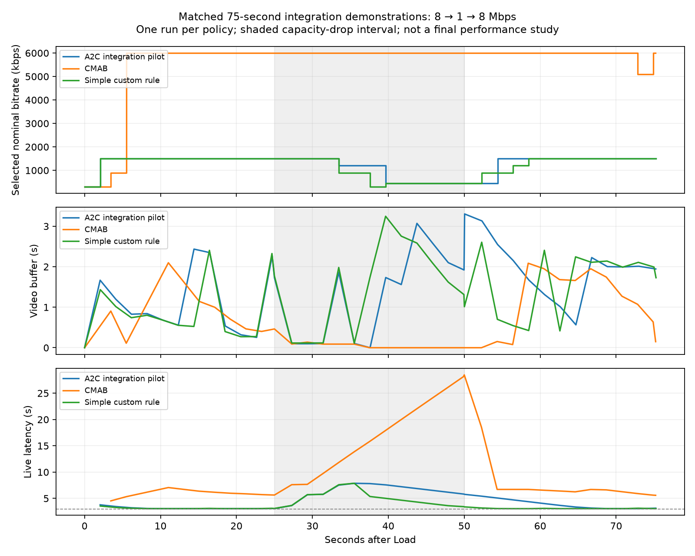

# Phase A handoff — Anjan

This batch completes roadmap Steps 1–6. The mid-review PowerPoint is Step 7 and has not been created. All changes are local in `LEO_ABR_RL`, on the parent and player submodule branches named `anjan`; nothing has been pushed.

## What works

| Step | Delivered evidence |
|---|---|
| 1. Host/repository | Recursive checkout, pinned revisions, WSL2/Docker/Chrome, working `NET_ADMIN`; setup records in `artifacts/setup/` |
| 2. Archived reproduction | 25 regenerated figures in `paper-figures/`, checked and visually inspected; these use the authors' archived measurements |
| 3. Fresh baselines | Actual CMAB, Dynamic, L2A-LL and LoL+ playback, MongoDB records and original-code plots; see `artifacts/baselines/verified.json` |
| 4. Custom rule | Selectable `abrAnjanSimple`, live throughput/buffer observations, representation/request/played-quality evidence, asynchronous logging through the existing backend |
| 5. Data | Source/media inventories; 48 training, 18 validation and 18 sealed test scenarios; deterministic generation and split checks; independent LENS RTT reserve |
| 6. Neural route | Faithful published-reference export; separately trained eight-action pilot; synchronous JavaScript inference; Node and real Chrome parity and timing evidence |

The simple rule's first controlled demonstration linked 39 completed requests to 40 decisions. Its median selected bitrate changed from 1.5 Mbps to 450 kbps and back when capacity changed from 8 to 1 to 8 Mbps.

The neural demonstration linked 37 completed requests to 39 decisions, used five quality levels, and had zero fallbacks. Every Chrome action matched the native checkpoint. Complete new-decision p50/p95/p99 was approximately **0.2/0.4/0.4 ms** on this laptop's Chrome container. Model asset loading plus warm-up took about 4.6 ms. The first page load also included development-bundle compilation; it is not a model-inference measurement. These are small-sample host measurements, not mobile-device results or a hard real-time guarantee.



These are one 75-second demonstration per policy, with matched media, minute/source phase, target latency, catch-up, player image and controlled network settings. They do **not** establish a statistically supported improvement over CMAB. `evidence-index.json` links the precise run IDs and measurements.

## Where things are and what Anjan owns

| Location | Purpose |
|---|---|
| `rl/` | Python preprocessing, minimal live environment, A2C training, teacher initialization, exports and learning checks. These are Anjan's ML deliverables. |
| `rl/web/` | Browser preprocessing, synchronous dense/Conv1d calculation, executable pilot weights and preload code. This is the inference package for Rajat. |
| `models/pilot/` | Selected native checkpoint, actor weights, normalization/action manifest and an input/output example. This is the eight-action player-compatible pilot. |
| `models/reference/`, `rl/reference/` | Pinned released Puffer/Maguro actor, faithful export and upstream source/license. This reference is not installed as the player policy. |
| `data/manifests/` | Provenance, media byte-size catalog, immutable split membership and scenario hashes. |
| `data/processed/`, `data/raw/` | Generated training inputs and downloaded LENS reserve; ignored by Git and reproducible using the scripts. |
| `dash.js/…/abr/anjan/AnjanRule.js` | Shared observation collector and request actuator for both new policies. Rajat can integrate this player wiring. |
| `patches/dashjs-anjan.patch` | Parent-packaged player changes, so an unpublished local submodule commit is not required to recreate them. |
| `Dockerfile-player-anjan`, `docker-compose.*.yaml` | Local-source player build, pinned service images and common shaper repair. |
| `scripts/` | Testbed, browser runs, data preparation and verification commands. |
| `artifacts/`, `figures/`, `paper-figures/` | Checks, logs, measured runs, MongoDB snapshots and plots. Large/raw outputs are ignored by Git. |
| `roadmap.md` | The existing plan and its progress tracker. Phase B remains unfinished. |

Anjan still owns the later calibrated training environment, strong RL baseline, LEO-specific inputs/model, repeatable final training, evaluation support, training plots and final integration package. This batch establishes the foundation and pilot; it does not complete those Phase B deliverables.

## What the two neural artifacts mean

**Published numerical reference:** the Plume repository links `sagar-pa/abr_rl_test` for its Puffer models. We pinned commit `b9c4069a947be0ba3a145ea65c7088e1a5402aea` and retained its MIT license. The selected Maguro checkpoint has ten actions, three Conv1d branches and future size/SSIM inputs. The repository does not identify its exact training run/seed. The chosen Maguro actor does not consume TCP cwnd/RTT fields, although the wider Puffer interface exposes them. Its missing SSIM/future metadata and ten-versus-eight actions prevent unchanged deployment here.

The faithful JavaScript reference matches Python on 64 native-format fixtures, including intermediate layers. Maximum absolute logit error was about `3.82e-5`, with identical actions. Fixtures are explicitly synthetic native-format checks, not claimed browser observations.

**Deployed integration pilot:** 36 causal inputs → 64 ReLU → 64 ReLU → eight action logits. A deterministic argmax maps through the real, sorted representation IDs. Its fixed normalization, model identity, example input/output and limitations are in `models/pilot/manifest.json`. JavaScript weights are about 143 KB. Python/Node parity passed on 40 recorded player inputs plus four startup/stale/extreme cases; actual Chrome decisions were checked independently.

Random-initialized A2C attempts collapsed to conservative actions; those diagnostics are retained. The delivered actor was initialized by imitating the simple causal policy on 12,000 **training-only simulated states**, then updated for 50,176 A2C decisions. It improved slightly over that warm-start policy in validation and uses all eight actions across validation cases. A fortuitous random initial actor scored higher on those same cases; this result is explicitly retained. There is no claim that this pilot beats Gelato, its teacher, or CMAB generally. See `artifacts/training/pilot-adjustments.json` and `learning-verification.json`.

The reward credits quality only while media is played and subtracts stalls, switching and excess live latency. The minimal environment includes live availability and approximate LoL+ catch-up/seeking. Full browser calibration, TCP/loss behavior, LEO observations, reward tuning and multiple seeds remain later work.

## Data boundaries and common repairs

The original one-hour RTT file and its replay CSV are the **same recording**. The pilot uses separated chronological blocks with 60-second guard gaps, then generates the five proposal scenario families plus mixed stress cases. Capacity and explicit interruptions are synthetic; measured RTT is labelled separately. Probe loss is not automatically treated as a full data-path outage. The two short measured throughput examples remain diagnostics. Test scenarios were structurally audited and have not been used for model selection.

A separate public LENS Victoria RTT recording was downloaded and gzip/CRC checked: 36.4 MB compressed, one hour, retained under `data/raw/lens/` for post-review calibration. It is not in this pilot's split. StarNet's public folder was reachable but its throughput dataset was not imported. The inventory and retrieval URLs record this accurately.

The source has eight two-second representations and a 60-second media loop. We audited actual encoded segment sizes against the serving container. Nominal bandwidth is not an accurate segment-size formula: the representation labelled 4.9 Mbps averages about 3.18 Mbps in these supplied files. The environment uses actual encoded bytes and labels nominal bitrate as a quality proxy.

The upstream shaper omitted its root HTB queue and used an invalid rate above its ceiling. `shaper/tc-phase-a.py` repairs this for **every** policy through a separate Compose override. Measured reverse throughput was 1.97 Mbps and 7.61 Mbps for configured 2/8 Mbps. The 40-ms outgoing delay was measured in ping; outage/recovery checks passed. Original non-positive-RTT replay behavior is retained as an emulation convention. A trace CMAB run with almost no real playback was preserved as a failed run; a stable-link control passed.

## Run commands on this laptop

Open a WSL Ubuntu-22.04 terminal and keep it open while using Docker; WSL may stop services after its final session exits. From PowerShell in `LEO_ABR_RL`, start or inspect the stack:

```powershell
wsl --distribution Ubuntu-22.04 --user root --cd /mnt/c/Users/HP/Desktop/LEO/LEO_ABR_RL --exec bash scripts/testbed.sh up
wsl --distribution Ubuntu-22.04 --user root --cd /mnt/c/Users/HP/Desktop/LEO/LEO_ABR_RL --exec bash scripts/testbed.sh status
```

`up` first checks/applies the packaged player patch on `anjan`, then builds the local source. It uses the pinned service lock and shared repair. The upstream example runner is not automatically started. Preserve these configurations when comparing policies.

The existing external Python environment was reused. No environment or temporary-work directory was created in the project:

```powershell
$py = "$env:LOCALAPPDATA\LEO-RL\venvs\contract-v1\Scripts\python.exe"
$env:PYTHONPYCACHEPREFIX = "$env:LOCALAPPDATA\LEO-RL\cache\pycache"
& $py scripts/browser_trial.py --algorithm abrAnjanRL --seconds 75 --stages 0:8,25:1,50:8
```

Choose `abrAnjanSimple` or `abrCMAB` using the same command for the other policies. The default catch-up explicitly matches the example's LoL+ setting. `scripts/matched_pilot_trials.py` runs all three at matched minute/source phases. `experiments/phase-a-custom.json` supplies the new labels and explicit catch-up for the authors' existing runner; mount it as `/batch.json` when using that runner.

To recreate development inputs or repeat the **pilot** when needed:

```powershell
& $py scripts/prepare_data.py
& $py scripts/audit_media.py --archive "$env:LOCALAPPDATA\LEO-RL\cache\WAVE.zip"
& $py scripts/check_data.py
& $py -m rl.check_env
& $py -m rl.train_pilot
& $py -m rl.export_pilot
node scripts/check_pilot_export.cjs
```

The default pilot command now includes the documented teacher warm-start and bounded 50k A2C fit. It overwrites current pilot outputs; archived diagnostic attempts remain separately labelled. Check `requirements-phase-a.txt` and `artifacts/setup/python-environment.json` for the exact Python 3.11 environment. Dependency resolution on a fresh external machine has not been independently tested. The player build and source patch were tested independently from a clean checkout of the pinned player source.

For the published reference only: `python -m rl.export_reference`, then `node scripts/check_reference_export.cjs`. Its executable forward pass is `LEO_SYNC_MATH.referenceActor(spec, nativeObservation)` in `rl/web/sync_actor.js`; its JSON weights are under `models/reference/`.

Stop services without deleting MongoDB data:

```powershell
wsl --distribution Ubuntu-22.04 --user root --cd /mnt/c/Users/HP/Desktop/LEO/LEO_ABR_RL --exec bash scripts/testbed.sh down
```

Do not add `-v` unless intentionally deleting the database. The delivered artifacts and exported MongoDB snapshots allow evidence inspection with the stack stopped.

## Remaining work

Step 7 consolidates this evidence into the mid-review PPT. Phase B then calibrates the environment, develops a stronger RL baseline and LEO-aware policy, performs repeatable training, compares runtimes and runs the sealed final CMAB comparison. The JavaScript/Pyodide/worker runtime study and asynchronous scheduling bridge remain future work.
