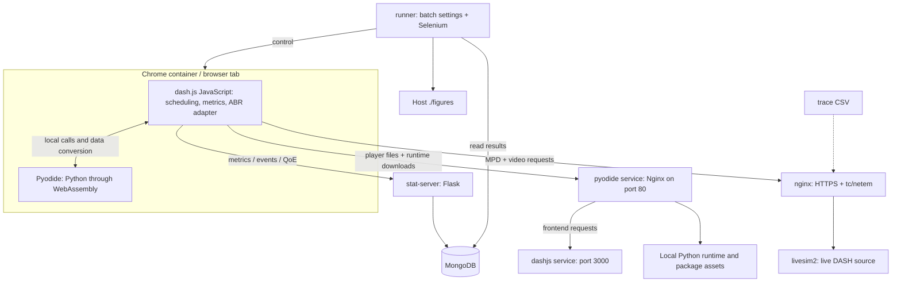

# Course project starter: RL ABR for live streaming over LEO networks

Updated: 28 October 2026.

This is the team and agent handoff for understanding this repository and building the course project. **The main work is to train and compare RL algorithms, observation designs, and rewards—not just insert one model into dash.js.** Use the repository as a streaming testbed and baseline implementation. Build a reusable training/evaluation layer alongside it.

## 1. Scope, status, and first steps

The project asks how a live-video player should select video quality when bandwidth, RTT, and handover disruptions vary. We want good picture quality, few stalls, stable quality, and low delay behind live.

The proposal discussions describe a Pensieve-style client-side RL ABR controller, with LEO-aware observations. Server-side congestion control/XCC is optional and outside the immediate focus. PPO was recommended in discussion as a practical candidate, **not selected as a proven winner**. Compare methods experimentally; preserve a Pensieve-style baseline and clearly label any departures from the original.

**What exists:** modified dash.js, CMAB/other ABR implementations, a live-source simulator, trace-driven packet shaping, Selenium experiment automation, metric collection, and plotting.

**What still needs building:** a fast training environment; shared observation/action/reward contracts; algorithm adapters and training scripts; reproducible experiment configuration; controlled evaluations and ablations; a deployed RL policy adapter in dash.js.

This document records source inspection and prior discussions. It does not certify that Docker experiments, the shaper, or an RL implementation have passed runtime checks. No training framework or RL integration was implemented while writing this document.

Recommended first milestones:

1. Validate one short existing browser run and confirm the shaper actually works.
2. Define a common simulator/observation/action/reward contract.
3. Validate simulator dynamics with hand-checkable scenarios and classical baselines.
4. Train a small first agent, then compare algorithms under identical conditions.
5. Study state and reward changes separately using ablations.
6. Deploy selected policies into Chrome and measure simulator-to-browser differences.

## 2. Essential terminology

- **DASH:** video is requested as segments, available in multiple encoded representations.
- **MPD:** manifest describing representations, segment addressing, and live availability.
- **ABR:** algorithm selecting which representation to request.
- **Action/quality index:** an integer into the manifest's representation list, not a bitrate value.
- **Bitrate:** encoded video data rate. It differs from measured download throughput.
- **Throughput:** rate at which data is delivered.
- **Buffer:** downloaded but unplayed media, in seconds.
- **RTT:** network round-trip time, usually milliseconds.
- **Live latency:** live source position minus player playback position, in seconds. RTT and live latency are different quantities.
- **Catch-up:** playback-speed changes or seeking to reduce live latency; separate from bitrate selection.
- **QoE:** a chosen numerical measure of viewing experience. There is no single universal reward formula.

A two-second segment at 6 Mbps contains approximately 12 megabits. At a constant 3 Mbps delivery rate it takes about four seconds to download, ignoring protocol overhead and live availability. A two-second buffer would not cover that download. Live/low-latency chunked delivery requires more detailed modeling than this whole-segment illustration.

## 3. Architecture: where code executes



### Docker services

All services share bridge network `dashjs`, subnet `192.167.0.0/24`:

- `dashjs`, `.101`: serves the player page and JavaScript bundle on container port 3000.
- `chrome`, `.102`: Selenium Chrome, port 4444; noVNC viewer on host port 7900.
- `runner`, `.103`: reads `/batch.json`, runs rounds, restarts shaping Nginx, generates results.
- `stat-server`, `.104`: receives player metrics on port 8000 and supports ping measurements.
- `mongo`, `.105`: database on port 27017; named volume `mongodb` persists data.
- `mongo-express`, `.106`: database viewer on host port 8081.
- `nginx`, `.107`: media reverse proxy on port 443, with `NET_ADMIN` for packet shaping.
- `livesim2`, `.108`: serves a simulated live DASH source on port 8888.
- `pyodide`, `.109`: Nginx serves Python assets and proxies frontend requests.

Compose mappings such as `4444:4444` fix the host port. Entries such as `"3000"` assign a host port automatically. Service-to-service calls use Docker names and container ports. `depends_on` sets ordering, not application readiness.

### The two meanings of Pyodide

The `pyodide` **Docker service is a file server/reverse proxy**. The Pyodide **runtime is a Python interpreter executing inside Chrome**. It is not a Python inference API server.

`webassembly/nginx.conf` routes requests as follows:

```text
http://pyodide/samples/.../testplayer.html
    → Nginx forwards to http://dashjs:3000/samples/.../testplayer.html

http://pyodide/pyodide/pyodide.js
    → Nginx serves a file from /var/www/pyodide
```

In `http://pyodide/pyodide/...`, the first `pyodide` is the hostname; the second is a URL path prefix. The runner opens the frontend through this proxy. The browser loads the dash.js bundle and Python assets, then executes them locally.

```javascript
// Initialization inside Chrome; download runtime once.
const pyodide = await loadPyodide({
    indexURL: 'http://pyodide/pyodide/'
});
await pyodide.loadPackage(['numpy']);

// Local computation inside Chrome, not an HTTP inference request.
const answer = pyodide.runPython('sum([10, 20, 30])'); // 60
```

The actual CMAB rule additionally loads pandas, SciPy, scikit-learn, MABWiser, ITU P.1203, and other dependencies. The asset image packages Pyodide 0.23.4. Check dependency compatibility with that pinned runtime before choosing Python browser inference.

## 4. What the paper's algorithm does—and why ours is different

This repo accompanies Zhao and Pan's MMSys 2024 paper, *Low-Latency Live Video Streaming over a Low-Earth-Orbit Satellite Network with DASH*. It is distinct from the Fang et al. reference discussed in the proposal. Do not merge the papers' methods or claims.

The custom `abrCMAB` path uses a **contextual bandit**, specifically MABWiser Linear Thompson Sampling. Its fitted input features are throughput, playback rate, and network latency. Live latency is recorded and affects reward, but is not one of those three fitted features.

The controller rebuilds/fits its model using history, resets history at hard-coded satellite time-slot boundaries, and initially chooses the highest representation until enough history exists. Python also computes ITU P.1203 `O46`. The implemented reward is approximately:

```text
P1203_O46 × (target_live_latency / current_live_latency)
          × (selected_bitrate / maximum_bitrate)
          − selected_bitrate_stall_time / total_stall_time
```

The stall ratio is zero when total stall time is zero. The code computes this score immediately using the selected representation and current measurements; it is not a complete delayed RL transition for the next segment.

**Bandit:** learn a good immediate reward for the current context.

**Sequential RL:** learn a policy maximizing expected future return, for example `E[sum(gamma^t * reward_t)]`. A large segment can drain the buffer now and cause a later stall, motivating sequential decisions. This does not guarantee RL will beat the bandit.

Original Pensieve uses A3C; a PPO adaptation is Pensieve-style, not an exact reproduction. The original on-demand formulation also needs explicit live-streaming adaptations.

## 5. Main development goal: an algorithm-independent RL environment

Do not embed training dynamics inside PPO or inside a dash.js rule. A shared environment lets us vary the algorithm, state, and reward independently.

```text
Trace + segment metadata + live-source configuration
                       │
                       ▼
              Streaming environment
            reset(seed), step(action)
                       │
           observation, reward, outcome
                       │
        ┌──────────────┼───────────────┐
        ▼              ▼               ▼
       PPO         A2C / A3C           DQN
                       │
                       ▼
          Common evaluation + raw metrics
```

Candidate methods, not implementation commitments:

- **PPO:** actor-critic with clipped policy updates; a reasonable first policy-gradient candidate.
- **A2C:** a simpler synchronous actor-critic comparison if useful.
- **A3C/Pensieve:** relevant for reproducing the reference; asynchronous training adds implementation complexity.
- **DQN variants:** fit a discrete bitrate action space; require replay/target-network and exploration choices appropriate to off-policy learning.
- **Classical policies:** throughput and buffer-based methods, plus this repo's existing algorithms, establish whether learning adds value.

Do not assume one training loop is interchangeable across these algorithms. PPO uses fresh on-policy rollouts; DQN uses replay. Compare training budgets and data exposure explicitly.

### Proposed layout (does not exist yet)

```text
rl/
  envs/streaming_env.py      # trace integration, buffer/playback/live clocks
  observations.py          # versioned feature builders and normalization
  rewards.py               # configurable reward terms
  traces.py                # parsing, split manifests, offsets
  policies/                # classical policies + inference interface
  training/                # algorithm adapters and entry point
  evaluation/              # common metrics, comparisons, ablations
  configs/                 # complete experiment specifications
  tests/                   # dynamics, contracts, export parity
```

Start with an environment interface like this (proposed pseudocode):

```python
obs, info = env.reset(seed=seed)
while True:
    action = policy.act(obs)
    next_obs, reward, terminated, truncated, info = env.step(action)
    # Training adapter records the transition in its required format.
    obs = next_obs
    if terminated or truncated:
        break
```

`info` should expose physical outcomes and reward components, not only the final scalar. Distinguish real termination from a time-limit truncation; value bootstrapping must respect that distinction.

### Required simulator semantics

- Advance download progress across changing bandwidth samples, not just `size / bandwidth_at_start`.
- Use actual encoded segment sizes where possible; bitrate × duration is an explicit approximation.
- Model outages, request timing, and RTT without double-counting them.
- Advance source/live and playback clocks separately; include startup, stalls, availability waits, catch-up, and seeks as supported by the chosen model.
- Buffer increases when playable media arrives and decreases with playback. A starting whole-segment model can use `stall = max(download_time - buffer, 0)` and `new_buffer = max(buffer - download_time, 0) + segment_duration` at 1×, but that excludes live availability and chunked playback.
- Document whole-segment versus low-latency chunk modeling. Validate selected scenarios against the browser before claiming equivalence.
- Reset all episode history and use explicit trace offsets/seeds.

Hand-check tests should cover constant capacity, zero-throughput outage, known segment sizes, empty-buffer startup, capacity changes during download, live availability, and episode boundaries.

## 6. Observation experiments: what state should the agent see?

Use an observation builder with a versioned schema. Candidate experiments:

1. **Basic:** throughput history, buffer, last quality/bitrate, recent download duration; segment size information if available to all comparable methods.
2. **Basic + RTT:** current/history RTT and freshness/missing-value mask.
3. **Basic + live latency:** latency and target latency.
4. **Basic + handover estimate:** only information available at decision time.
5. **Combined LEO-aware:** selected features above.

Specify each feature's units, order, history window, sampling/decision cadence, clipping, normalization, and startup padding. Fit normalization using training data only and save it with the model.

```python
# Illustrative contract, not a fixed final design.
observation = {
    'throughput_mbps_history': [...],
    'download_seconds_history': [...],
    'buffer_seconds': 2.8,
    'last_quality_index': 2,
    'live_latency_seconds': 3.5,
    'rtt_ms': 140,
    'rtt_age_seconds': 0.2,
    'handover_estimate': 0,
}
```

**Avoid future leakage.** A handover label from future CSV samples is privileged information. If used, label that experiment as an oracle upper bound. A practical detector or a periodic timing assumption must be evaluated separately. The paper's approximately 15-second timing pattern is a measurement-specific assumption, not a universal LEO guarantee.

Do not confuse the CSV's scripted delay with the stats service's observed ping or with browser live latency. Decide which signal the policy actually receives in both simulator and browser.

## 7. Reward experiments: what behavior are we teaching?

Start with a transparent configurable family, rather than silently adopting the CMAB score:

```text
r_quality × quality(selected representation)
−r_stall   × newly incurred stall seconds
−r_switch  × absolute quality change
−r_latency × live-latency penalty
```

Choices to record:

- Quality utility: bitrate, normalized bitrate, log bitrate, or a perceptual measure.
- Switch penalty: bitrate difference, log-quality difference, or representation change count.
- Latency penalty: absolute latency or excess above target; decide whether integrated over time or sampled at a decision.
- Startup delay and seek/skipped-content penalties: explicit inclusion or separate reporting.
- Weights and units: put them in config; log each component.

For variable-duration decisions, define whether reward is per segment or integrated over elapsed/media time. Longer downloads must not accidentally escape latency penalties merely because they produce fewer decisions. Document per-step discounting versus any time-aware discount choice.

**Reward timing matters:** observe the consequences of action `a_t` before forming `(s_t, a_t, r_t, s_t+1)`. Browser rule calls are not automatically one call per completed segment. Associate decisions, requested segments, downloaded/appended media, stalls, and actual qualities through IDs/timestamps. Stalls can have delayed causes; document the credit-assignment convention.

Evaluate all policies with common physical metrics and a shared evaluation objective. Returns from differently weighted training rewards are not directly comparable.

## 8. Training, testing, and fair comparisons

### Suggested experimental sequence

1. Establish throughput/buffer baselines and simulator correctness.
2. Train one small PPO policy with a basic observation and fixed reward.
3. Compare algorithm candidates with the same observation, reward, traces, and evaluation protocol.
4. Hold algorithm/reward fixed and ablate observation features.
5. Hold algorithm/observation fixed and sweep reward weights or terms.
6. Select candidates on validation data, then evaluate on untouched test traces.
7. Validate selected candidates in the Docker browser testbed.

Avoid beginning with a huge algorithm × state × reward grid. A staged experiment design makes results easier to interpret and saves compute.

### Dataset and reproducibility requirements

- Split by independent trace/session or appropriately separated time blocks; adjacent overlapping windows must not leak across train/test.
- Separate training, validation, and final test manifests. Synthetic generators need independent seeds and held-out parameter regimes.
- Include stable conditions, bandwidth changes, RTT changes, outages/handover recovery, and unseen combinations.
- Run multiple training seeds and paired evaluation traces/offsets across policies.
- Report sample budget, wall time, tuning budget, and model size. Equal optimizer updates do not imply equal data exposure.
- Save checkpoint, config, normalizer, trace identifiers/checksums, seed, code commits, dependency versions, and evaluation outputs.
- Freeze policy parameters during final evaluation. State explicitly whether actions are greedy/deterministic or sampled. Keep online adaptation a separate experiment.

Proposed config shape:

```yaml
algorithm: ppo
seed: 0
environment:
  train_manifest: splits/train.json
  validation_manifest: splits/validation.json
  test_manifest: splits/test.json
observation:
  version: basic-rtt-v1
  history_length: 8
reward:
  version: quality-stall-switch-latency-v1
  quality_utility: log_bitrate
  weights: {quality: 1.0, stall: 4.0, switch: 1.0, latency: 0.5}
evaluation:
  deterministic: true
```

These values are illustrative, not tuned recommendations. Add training budget, network architecture, action mapping, live-source/catch-up settings, normalization, and complete algorithm hyperparameters before relying on a run.

### What to measure

- Mean delivered/played bitrate and quality distribution.
- Stall duration, stall count, and stall ratio with an explicit denominator.
- Startup delay.
- Quality-switch count and magnitude.
- Mean and tail live latency, plus time over target.
- Playback rate, seeks, and skipped content if enabled.
- Common QoE components and aggregate score.
- Inference latency, invalid actions, fallback frequency, and initialization time.
- Performance specifically around handovers and recovery.

Report aggregate results across seeds/traces and variability, plus temporal plots explaining failures. Reward improvement alone is insufficient evidence. A zero-buffer sample alone is not a reliable full stall-duration measurement; derive stalls from appropriate events/timestamps.

### PPO reminder for agents implementing training

The actor outputs action probabilities; the critic estimates expected return. Collect observations, actions, rewards, old log probabilities, value estimates, and termination/truncation information. Compute returns/advantages with correct episode boundaries; use the old-policy log probabilities as fixed data during clipped updates. Track entropy, value loss, approximate KL, and policy behavior. Export only inference-required components, plus observation preprocessing and action metadata. The prior PPO examples were educational CartPole explanations, not a completed ABR trainer.

## 9. Browser deployment: connect a trained policy to dash.js

Recommended initial mode: train offline in Python, freeze a checkpoint, then run inference while Chrome streams real media. Online browser training is a separate, slower undertaking.

### Choose an inference route deliberately

- **Pyodide + NumPy:** suitable if the network can be reproduced with supported operations; mirrors the existing Python bridge.
- **Browser model runtime:** export a compatible model and call it from JavaScript; Pyodide is unnecessary for that inference route.
- **Python inference service:** keeps native framework support but requires a new service, API, readiness, timeout, and asynchronous decision design. It is not the current CMAB architecture.

Weights do not have to be JSON. JSON was a readable small-model example. NumPy archives or a supported model-export format may be better. A `.pt` checkpoint does not automatically run inside Pyodide. Save architecture, activations, normalization, action mapping, and versions alongside weights. Verify exported outputs against the training implementation on identical observations.

### Extension checklist

1. Add `ABR_STRATEGY_RL = 'abrRL'` in `dash.js/src/streaming/constants/Constants.js`.
2. Add `rl/RLRule.js` alongside existing ABR rules and register it in `ABRRulesCollection.js`.
3. Follow `CMABRule.js` for FactoryMaker/SwitchRequest plumbing and measurement access.
4. Build the same observation used in training; validate action bounds against the current bitrate ladder.
5. Initialize the model once; maintain histories/recurrent state and clear them on reset.
6. Add a radio input with `name="abr-general"`, `value="abrRL"`, and `id="abrRL"` in the testplayer HTML. URL parsing selects by ID.
7. Expose policy readiness and errors so Selenium waits for successful initialization before timed playback.
8. Record requested and actual quality, observation, model ID, inference duration, and fallback use.

The existing path is synchronous: `ABRRulesCollection` calls `getMaxIndex()` and immediately reads its SwitchRequest. Returning a Promise will not make it wait. Heavy Python inference can block the browser; use a lightweight implementation or design asynchronous precomputation with fresh cached decisions and explicit fallback behavior.

```javascript
// Simplified existing-style bridge, after runtime/model initialization.
window.rl_observation_json = JSON.stringify(observation);
const action = pyodide.runPython(`
import json
from js import rl_observation_json
obs = json.loads(str(rl_observation_json))
int(policy.predict(obs))
`);
// Validate integer, range, and freshness before setting request.quality.
```

Safety and abandonment rules must be explicit. Existing CMAB/LoLP branches bypass extra rules registered in the default branch. A new rule copied from them will inherit that behavior. Log overrides so the deployed policy's actions remain interpretable.

## 10. Running experiments and ensuring local changes are used

### Existing short-run workflow

Use a Linux experiment machine compatible with the artifact's requirements; the published setup used Debian x86-64. Mac-host Docker behavior and image/platform compatibility need validation rather than assumed equivalence.

```bash
git submodule update --init --recursive
docker compose -f docker-compose-emulation.yaml config
docker compose -f docker-compose-emulation.yaml pull
docker compose -f docker-compose-emulation.yaml up -d
docker logs -f dashjs-runner
```

The checked-in Compose file mounts **`experiments/batch-example.json`**, not the README's long batch. It runs one 60-second CMAB round with target latency 3 seconds and LoLP catch-up. `VIDEO=0` disables recording-container creation, not Chrome's noVNC viewer. View it at `http://<host>:7900/?autoconnect=1&resize=scale&password=secret`.

For `EMULATION=true`, current runner output goes under:

```text
./figures/emulation/target-3s/<experiment-id>/
```

The README's `figures-emulation` wording does not match this current mount/code path. Confirm the resolved Compose configuration and actual export directory.

Stop the stack when done:

```bash
docker compose -f docker-compose-emulation.yaml down
```

### Local development build trap

**Editing local `dash.js/` does not change the existing prebuilt Docker image.** `Dockerfile-dashjs` clones an upstream remote branch rather than copying local source. `Dockerfile-livesim2` also clones remote source. Create a local build path or a deliberate development mount; verify the running bundle with a unique build/model marker.

Example new `Dockerfile-dashjs-local` (proposed file):

```dockerfile
FROM node:18.16.1
WORKDIR /app
COPY dash.js/ ./
RUN npm install
CMD ["npm", "run", "start"]
```

Example new `docker-compose-rl.yaml` (proposed file):

```yaml
services:
  dashjs:
    image: dashjs-rl:local
    build:
      context: .
      dockerfile: Dockerfile-dashjs-local
  pyodide:
    image: dashjs-pyodide-rl:local
    build:
      context: ./webassembly
      dockerfile: Dockerfile
  runner:
    volumes:
      - ./experiments/batch-rl.json:/batch.json
```

The same-target runner mount replaces the base `/batch.json` mount. Build/recreate using both files; inspect merged config first. These example files are not created by this document.

```bash
docker compose -f docker-compose-emulation.yaml -f docker-compose-rl.yaml config
docker compose -f docker-compose-emulation.yaml -f docker-compose-rl.yaml build dashjs pyodide runner
docker compose -f docker-compose-emulation.yaml -f docker-compose-rl.yaml up -d
```

In a copy of `batch-example.json`, set `ABR_ALGORITHM` to `abrRL`. Keep currently required fields such as `CMAB_ALPHA` even if the new rule ignores them. Additional JSON fields need explicit propagation through `runner/config.py`, `runner/single_runner.py`, player URL parsing/settings, and the policy adapter. A field added only to JSON is not automatically available in Chrome.

The runner closes the browser each round. Persist online training state deliberately if that mode is ever implemented. Experiment IDs are time-based and not a complete reproducibility identity; add a run UUID/config hash/checkpoint reference.

## 11. Validate the emulator before using its measurements

The active shaping process is `runner/tc-trace.py`, launched by `shaper/supervisord.conf`; it is not the separate periodic example in `runner/tc.py`.

Current behavior from source:

- Mounts `runner/trace/isl-trace.csv` at `/trace/trace.csv`.
- Uses the first `since` column as elapsed time and selects the nearest sample. The second column is not used for scheduling.
- Sleeps approximately 10 ms per loop, plus processing overhead; each lookup scans the trace.
- Truncates RTT values to integers and applies them directly as Nginx `eth0` outgoing delay.
- Normal samples use 1% loss. Values `0` or `-1` trigger 100% loss and a nominal 100 ms delay.
- Bandwidth parameters are hard-coded, not read from this CSV. A fixed configured limit does not imply constant observed throughput.
- Runner restarts Nginx each round, restarting trace timing before browser setup; playback starts later. Trace replay does not wrap explicitly at its end; nearest-sample selection stays at the last sample.

**Source-level issues requiring runtime verification/fixing:** initialization adds a class under `1:` without first creating its root qdisc in this script. HTB `rate 100mbit` is paired with lower `ceil` values (50 Mbit initially, 20 Mbit during replay). Commands can fail; do not claim a validated bandwidth cap from these values. Supervisor may repeatedly restart a failing script while Nginx itself continues serving.

Inspect logs and installed qdiscs/classes:

```bash
docker compose -f docker-compose-emulation.yaml logs nginx
docker exec dashjs-nginx tc -s qdisc show dev eth0
docker exec dashjs-nginx tc -s class show dev eth0
```

Then measure effective delay, loss, outages, and throughput with controlled traffic. RTT replayed as one-direction delay is not a faithful reconstruction of the original two-direction path. If the project needs bandwidth variation, add and validate a bandwidth trace/generator rather than assuming this CSV provides it.

Only traffic leaving shaping Nginx is directly impaired; Chrome-to-stats reporting follows another path. ICMP responses from Nginx can encounter its egress shaping, but verify the actual ping target/path. The stats endpoint can return zero without measurements and reuse the last RTT on failed pings; provide freshness and missingness to the agent rather than treating all returned values as current ground truth.

For paired experiments, align trace time to a defined playback start and log the offset. The existing pre-browser restart plus fixed waits is insufficient for exact alignment.

## 12. Measurement backend and known logging limitations

`stats-server/app.py` writes to MongoDB database `starlink`:

- `/event/<experimentID>` → `events-<experimentID>`.
- `/metric/<experimentID>` → `metric-<experimentID>`.
- `/qoe/` → `qoe-<current_experiment_id>`.
- `/ping/<hostname>` starts probing; `/ping` returns the latest reported RTT.

`/qoe/` uses a process-global current experiment ID set by event/metric requests. This assumes sequential activity and risks incorrect association before the ID is set or with concurrent experiments. New RL transition logging should carry an explicit experiment ID and timestamps/decision IDs.

Player metric samples include bitrate, buffer, live latency, and playback rate. `runner/plot.py` exports JSON and PNG files including bitrate/switch, buffer, latency, playback-rate, QoE, and arms data. New algorithm-specific metrics need explicit logging/export support. An empty QoE plot for a policy that sends no QoE reports is not a successful evaluation result.

## 13. Source reading order and file map

1. [README.md](README.md): artifact modes and prerequisites.
2. [docker-compose-emulation.yaml](docker-compose-emulation.yaml): actual service wiring and mounted batch.
3. [runner/config.py](runner/config.py), [batch_runner.py](runner/batch_runner.py), [single_runner.py](runner/single_runner.py): config → round → Selenium → plots.
4. [testplayer/main.js](dash.js/samples/starlink/testplayer/main.js): URL settings, player initialization, metrics.
5. [ABRRulesCollection.js](dash.js/src/streaming/rules/abr/ABRRulesCollection.js): strategy registration and synchronous rule arbitration.
6. [CMABRule.js](dash.js/src/streaming/rules/abr/cmab/CMABRule.js), [CMABAbrController.js](dash.js/src/streaming/rules/abr/cmab/CMABAbrController.js): browser Python and custom decision logic.
7. [webassembly/nginx.conf](webassembly/nginx.conf), [webassembly/Dockerfile](webassembly/Dockerfile): proxy and runtime/package assets.
8. [runner/tc-trace.py](runner/tc-trace.py), [shaper/supervisord.conf](shaper/supervisord.conf): active emulator.
9. [stats-server/app.py](stats-server/app.py), [runner/plot.py](runner/plot.py): raw storage and exports.
10. [etc/nginx/conf.d/livesim2.conf](etc/nginx/conf.d/livesim2.conf): media proxy routing.

## 14. Efficient team and agent handoff

Suggested independent work areas, after agreeing on contracts:

- Environment/traces: dynamics, data splits, hand-check tests, browser calibration.
- Training/algorithms: adapters, seeds, checkpoints, learning diagnostics.
- State/reward/evaluation: feature builders, component logging, ablations, paired comparisons.
- Browser/testbed: local builds, RL rule, readiness, emulator verification, telemetry.

Do not duplicate environment logic across algorithms. Agree on observation schemas, action mapping, reward timing, and evaluation metrics before parallel implementation. Keep each run's artifacts and a brief experiment ledger containing hypothesis, config, command, result location, and conclusion.

For an agent picking this up:

1. Read this document, then inspect current code/config; facts here are a snapshot.
2. Check repository instructions, `git status`, submodule state, and runtime availability before edits.
3. State which layer is being changed: training, observation/reward, inference, browser, or emulation.
4. Preserve baselines and keep algorithm/state/reward changes separately configurable.
5. Run targeted verification and report actual evidence. Do not infer successful emulation from a running Nginx container.
6. Update this guide when contracts, commands, or validated assumptions change.

`dash.js`, `livesim2`, and `paper-data` are Git submodules. Their source is populated in the current checkout, correcting older chats that observed empty directories. Changes inside a submodule require their own commits and a parent pointer update; teammates need access to the relevant fork/commit. The parent repository currently points to the team's fork, but submodule remotes remain separate.

## 15. Discussion provenance and unresolved decisions

Synthesized from the accessible relevant chats: **Explain project problem and approach**, **Explain ABR Solution Planning**, **Explain RL Solution**, **Explain PPO Implementation**, **Explaining Model Free RL** (relevant RL portions), **Explain the repository**, and **Explain Docker Compose emulation**. Prior explanations were checked against current local source where applicable; educational snippets and recommendations are not implemented features. The original proposal/paper attachments were discussed in those chats; this guide does not newly certify all attachment requirements.

Still to settle as a team:

- First simulator fidelity level and its calibration criteria.
- Initial algorithm set and whether an exact original Pensieve reproduction is required.
- Observation histories, normalization, and practical handover signal.
- Reward utility, weights, timing, and common evaluation objective.
- Training/test trace splits, budgets, seeds, and model-selection rules.
- Browser inference format and latency budget.
- Whether proposal requirements require an FFmpeg live pipeline beyond the existing livesim2 source.

The first useful result is a **validated baseline plus a reproducible end-to-end training/evaluation run**. Algorithm, state, and reward experiments can then build on the same trusted infrastructure.
